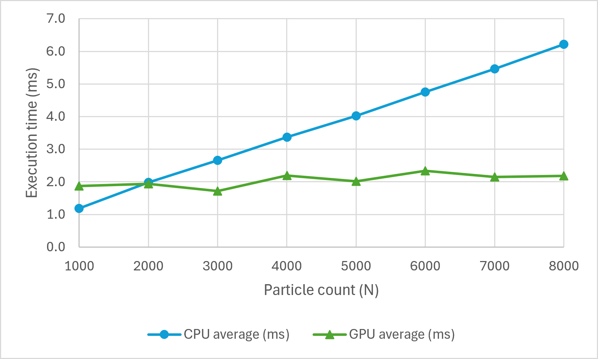
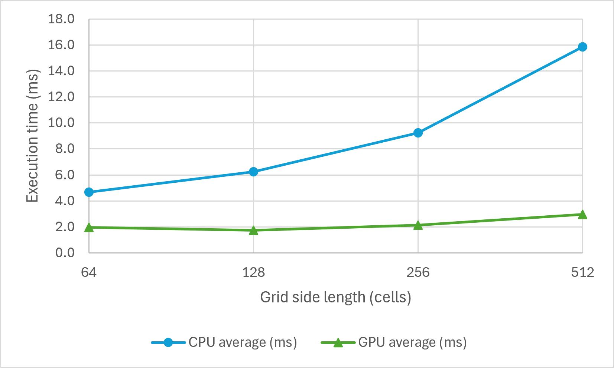
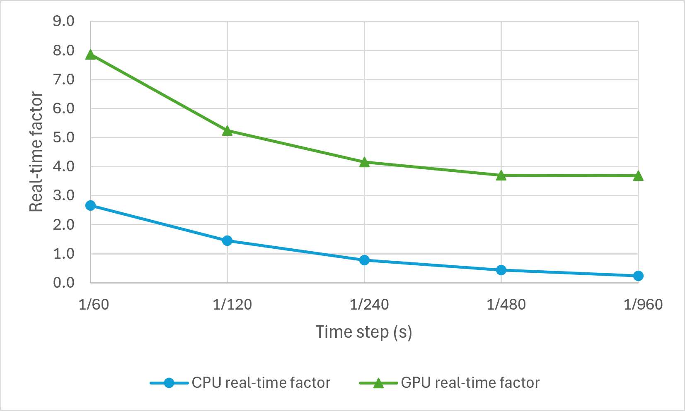

# Real-time GPU-based collision detection for 2D circular particles in Vulkan

  <!-- Both the rel and target attributes' assigned values are an attempt to make the link open in a new tab/window though both may be blocked by GitHub sanitisation -->
  
  <a href="https://youtu.be/tpTzlMHCx9w" target="_blank"> 
    <!-- If <tt> and <i> are moved on separate lines, then extra empty underlined lines are produced in the rendered output -->
    <tt><i>(Click on gif for a longer side-by-side showcase of different simulation versions)</i></tt>
  </a>

## Project Overview

Implementation of a circumference-sampling variant of the neighbour search collision detection algorithm outlined by [Atencio et al, 2025](https://link.springer.com/chapter/10.1007/978-3-031-92608-2_15) on a CPU and a GPU in Vulkan using C++20 for CPU code and GLSL for shader code. Both versions have their collision detection and resolution execution times compared as particle count rises and as grid resolution increases. In addition, the real-time factor (RTF) of both versions is compared as the the fixed time step parameter shrinks.

## Dependencies

The project uses [CMake](https://cmake.org/) for building and linking dependencies. In addition, it utilises the following libraries and tools:
- [Simple DirectMedia Layer (SDL3)](https://github.com/libsdl-org/SDL) - for window creation and simple input detection
- [Volk](https://github.com/zeux/volk) - to dynamically load entrypoints required to use Vulkan
- [Vulkan Memory Allocator (VMA)](https://github.com/GPUOpen-LibrariesAndSDKs/VulkanMemoryAllocator) - to simplify memory allocation operations
- [OpenGL Mathematics (GLM)](https://github.com/g-truc/glm) - for the `vec2` data type and some vector functions such as `dot()` and `normalize()`
- [glslc](https://github.com/google/shaderc/tree/main/glslc) - for statically compiling shaders to produce SPIR-V binaries

## Code File Structure

- `application.cpp / .h` - defines `Application` class which stores Vulkan-related data and behaviour
- `main.cpp` - creates an `Application` object and calls its top-level functions
- `particle.h` - data structure representing a single particle. It stores a center position, velocity and a radius, in addition to some padding to align with GLSL's std430 data-layout rule
- `cell.h` - data structure representing a single cell in the flat uniform grid array used in the implementation of the neighbour search algorithm
- `particle_spawner.cpp / .h` - defines a `ParticleSpawner` class used to initialise all members of a particle array with randomly-generated radius lengths within a specific range and based on remaining simulation area and then spawn them in waves
- `simulation_constants.h` - holds a namespace containing simulation-related constants used across multiple files
- `timer.h` - defines a `Timer` class used to limit iterations of the `update()` loop in each frame based on a fixed time step as well as to provide a current timestamp used to avoid narrow collision detection checks with particles from cells with stale data
- `cpu_physics.cpp / .h` - contains a nested `cpu::physics` namespace holding the following free functions:
  * `applyGravity()` - uses semi-implicit Euler integration to update the position of a particle
  * `mapParticle()` - based on Algorithm 1 from [Atencio et al, 2025](https://link.springer.com/chapter/10.1007/978-3-031-92608-2_15). Maps a particle to all cells its area overlaps (except for cells which already have a set number of particles mapped to them)
  * `collisionDetection()` - based on Algorithm 2 from [Atencio et al, 2025](https://link.springer.com/chapter/10.1007/978-3-031-92608-2_15) for collision detection
  * `checkCollision()` - confirms whether 2 particles are colliding by comparing the distance between their centers to the sum of their radii
  * `adjustPositions()` - separates 2 overlapping particles by moving each in the opposite direction of their respective collision normal
  * `resolveCollision()` - applies an impulse-based collision response based on the teachings of [Eug Kenny](https://eugkenny.github.io/GADV8001/lectures/Collision%20Response%20-%20Impulse%20Methods.pdf)
  * `resolveBoundaryCollisions()` - pushes a particle back inside of the simulation area if it hits the left or right boundary. Stops particle from falling further if it hits the bottom simulation area boundary
- `benchmarker.cpp / .h` - defines a `Benchmarker` class which is used to record execution times across a chosen number of iterations of the  `update()` loop, after the chosen number of warm-up iterations have passed
- `shaders/` - folder for GLSL shader code
  * `comp_common.h` - contains common compute shader code such as specialization constant declarations and shader storage blocks for the particle and cell arrays
  * `grid.comp` - holds code which applies the force of gravity to a particle as well as a GPU-adapted version of the `mapParticle()` function from the `cpu::physics` namespace
  * `collision.comp` - holds GPU-adapted versions of `cpu::physics` code for collision detection and resolution
  * `circle.vert` - defines an array of 4 vertices to represent a quad, receives data representing a position and a radius through vertex input attributes and passes them along to the fragment shader, together with an interpolated fragment position which has been scaled and transformed based on the input data
  * `circle.frag` - has code which cuts out a hollowed out circle from a quad based on the input data from the vertex shader and a fixed `outlineThickness` value

## GPU Implementation Highlights

- **1:1 particle-to-thread mapping** - each active thread is responsible for a single particle only
- **Atomic concurrency** - `atomicAdd()` is used when particles are mapped to the grid to avoid data races when particle IDs are being added to a cell's array of occupant IDs
- **Deduplication pass** - an extra array of processed particle IDs is used to reduce instances where the same impulse response from single particles registered in multiple cells is applied to the same particle
- **Accumulated state updates** - unlike the CPU version of the algorithm, displacement and velocity changes from surrounding colliding particles are accumulated in variables and applied to the thread's particle at the end
- **Buffer clearing via `vkCmdFillBuffer()`** - Stale data from previous update() iterations cleared by filling buffer data with zeroes, instead of the timestamp comparison approach of the CPU version

## Results

The data shown in this section was gathered on a system with the following specs:
- 16 GB of RAM
- Intel Core i7-7700 CPU
- NVIDIA GeForce GTX 1080 Ti GPU
- Windows 10 Pro 64-bit OS

### Data Gathering Process

For both versions the program waits 400 iterations from the start of each simulation before recording 1000 `update()` loop iterations' execution times and this process is repeated five times per tested parameter value per device.

All tests use the same pseudorandom number generator seed for particle radius and the same boundaries - 0.008 minimum radius and 0.16 maximum radius (where the simulation area is always 4 square units). So a particle can be no more than 20 times larger than the smallest particle. Most other simulation parameters are also constant across test types, except for the single parameter which is the focus of the respective test. For example, gravity is always a (0.0, 0.0981) vector in simulation units, max particles per cell (before the algorithm stops mapping particles IDs to a given cell in a given iteration) is always 32, elasticity is always 1.0, and the velocity damper is kept at 0.99.

The `chrono::steady_clock` C++ standard library feature is used to record CPU execution times, and Vulkan timestamp queries are used to record GPU execution times.

### Performance Based on Particle Count

For all data collected in this test, the same time step of $\frac{1}{60}$ seconds and grid side length of 128 cells is used. Particle count varies between 1000-8000 in increments of 1000.

<table align="center">
  <caption>
    

      <samp>
        <b>
          CPU and GPU execution time metrics based on particle count
        </b>
      </samp>
    

  </caption>
  <thead>
    <tr>
      <th rowspan="2">Particle count</th>
      <th colspan="3">CPU</th>
      <th colspan="3">GPU</th>
      <th rowspan="2">Speedup</th>
    </tr>
    <tr>
      <th>Average (ms)</th>
      <th>Median (ms)</th>
      <th>StdDev (σ)</th>
      <th>Average (ms)</th>
      <th>Median (ms)</th>
      <th>StdDev (σ)</th>
    </tr>
  </thead>
  <tbody align="right">
    <tr><td>1000</td><td>1.1901</td><td>1.1703</td><td>0.0769</td><td>1.8777</td><td>1.9922</td><td>0.3567</td><td>0.6338</td></tr>
    <tr><td>2000</td><td>1.9851</td><td>1.9468</td><td>0.1309</td><td>1.9414</td><td>2.0337</td><td>0.3312</td><td>1.0225</td></tr>
    <tr><td>3000</td><td>2.6551</td><td>2.6179</td><td>0.1338</td><td>1.7176</td><td>1.8360</td><td>0.4270</td><td>1.5458</td></tr>
    <tr><td>4000</td><td>3.3645</td><td>3.3265</td><td>0.1499</td><td>2.1974</td><td>2.1668</td><td>0.4295</td><td>1.5311</td></tr>
    <tr><td>5000</td><td>4.0233</td><td>4.0017</td><td>0.0983</td><td>2.0182</td><td>2.1043</td><td>0.4249</td><td>1.9935</td></tr>
    <tr><td>6000</td><td>4.7492</td><td>4.7034</td><td>0.1905</td><td>2.3420</td><td>2.4079</td><td>0.3986</td><td>2.0279</td></tr>
    <tr><td>7000</td><td>5.4668</td><td>5.4232</td><td>0.1691</td><td>2.1487</td><td>2.2159</td><td>0.4508</td><td>2.5442</td></tr>
    <tr><td>8000</td><td>6.2167</td><td>6.1424</td><td>0.2741</td><td>2.1810</td><td>2.2405</td><td>0.5254</td><td>2.8504</td></tr>
  </tbody>
</table>

From the tested range, average CPU execution time is only faster from 1000 to a little before 2000 particles. Afterwards, the GPU takes over in terms of speed, culminating in a **2.85× speedup** at a particle count of 8000.

   
  <figcaption>
    <samp>
      <b>
        Average physics update execution time scaling by particle count
      </b>
    </samp>
  </figcaption>

### Performance Based on Grid Resolution

For data collected in this grid scale-based test, a constant time step of $\frac{1}{60}$ seconds and
a particle count of 8000 is used. Grid side length varies from 64 to 512 cells with each
tested value being twice as large as the previous one.

<table align="center">
  <caption>
    

      <samp>
        <b>
          CPU and GPU execution time metrics based on grid side length in cells
        </b>
      </samp>
    

  </caption>
  <thead>
    <tr>
      <th rowspan="2">Grid side length</th>
      <th colspan="3">CPU</th>
      <th colspan="3">GPU</th>
      <th rowspan="2">Speedup</th>
    </tr>
    <tr>
      <th>Average (ms)</th>
      <th>Median (ms)</th>
      <th>StdDev (σ)</th>
      <th>Average (ms)</th>
      <th>Median (ms)</th>
      <th>StdDev (σ)</th>
    </tr>
  </thead>
  <tbody align="right">
    <tr><td>64</td><td>4.6670</td><td>4.6338</td><td>0.1495</td><td>1.9578</td><td>1.7572</td><td>0.4312</td><td>2.3838</td></tr>
    <tr><td>128</td><td>6.2573</td><td>6.2248</td><td>0.1637</td><td>1.7282</td><td>1.6768</td><td>0.7871</td><td>3.6208</td></tr>
    <tr><td>256</td><td>9.2370</td><td>9.1676</td><td>0.3234</td><td>2.1341</td><td>2.0803</td><td>0.8164</td><td>4.3283</td></tr>
    <tr><td>512</td><td>15.8434</td><td>15.7012</td><td>0.5991</td><td>2.9679</td><td>2.8416</td><td>0.9892</td><td>5.3383</td></tr>
  </tbody>
</table>

Within the recorded grid resolution range, the GPU version's collision detection and resolution execution times for 8000 particles are always faster than its CPU counterpart. The GPU version's advantage keeps widening as the grid side length increases, reaching a **5.33× speedup** at a grid granularity of 512×512 cells.

   
  <figcaption>
    <samp>
      <b>
        Average physics update execution time scaling by grid side length. The horizontal axis uses a log2 scale
      </b>
    </samp>
  </figcaption>

### Effect of Time Step Scaling

In this test, where time step is the parameter being varied, a particle count of 8000 and
a grid resolution of 128×128 cells is used. The time step varies between $\frac{1}{60}s$ and $\frac{1}{960}s$ with each step being half as large as the previous one.

<table align="center">
  <caption>
    

      <samp>
        <b>
          CPU and GPU performance metrics based on simulation time step
        </b>
      </samp>
    

  </caption>
  <thead>
    <tr>
      <th rowspan="2">Time step (s)</th>
      <th colspan="4">CPU</th>
      <th colspan="4">GPU</th>
    </tr>
    <tr>
      <th>Average (ms)</th>
      <th>Median (ms)</th>
      <th>StdDev (σ)</th>
      <th>RTF</th>
      <th>Average (ms)</th>
      <th>Median (ms)</th>
      <th>StdDev (σ)</th>
      <th>RTF</th>
    </tr>
  </thead>
  <tbody align="right">
    <tr><td>1/60</td><td>6.2486</td><td>6.1428</td><td>0.3150</td><td>2.6673</td><td>2.1204</td><td>2.2129</td><td>0.5433</td><td>7.8601</td></tr>
    <tr><td>1/120</td><td>5.7361</td><td>5.7166</td><td>0.1278</td><td>1.4528</td><td>1.5893</td><td>1.4925</td><td>0.3620</td><td>5.2434</td></tr>
    <tr><td>1/240</td><td>5.3033</td><td>5.3007</td><td>0.1363</td><td>0.7857</td><td>1.0004</td><td>0.9513</td><td>0.1977</td><td>4.1649</td></tr>
    <tr><td>1/480</td><td>4.7287</td><td>4.6949</td><td>0.1774</td><td>0.4406</td><td>0.5636</td><td>0.5622</td><td>0.0460</td><td>3.6962</td></tr>
    <tr><td>1/960</td><td>4.3772</td><td>4.3071</td><td>0.2631</td><td>0.2380</td><td>0.2822</td><td>0.2826</td><td>0.0226</td><td>3.6916</td></tr>
  </tbody>
</table>

With 8000 particles, the CPU version loses the ability to simulate virtual time as fast or faster than real time at a time step between $\frac{1}{120}s$ and $\frac{1}{240}s$. Meanwhile, the GPU is able to maintain sumulated time faster than real-word time throughout the tested time step range.

   
  <figcaption>
    <samp>
      <b>
        Real-time factor scaling by shrinking time step for a workload of 8000 particles. The horizontal axis uses a log2 scale
      </b>
    </samp>
  </figcaption>

## References

- **[Learn Modern Vulkan in 2 Hours (Dynamic Rendering, No Render Passes!)](https://www.youtube.com/watch?v=DC9FBRQKNck)** - the initial resource used to learn the basics of Vulkan. The [codebase](https://github.com/nickenchev/modern-vulkan/tree/lesson_01) associated with it was studied and rewritten by hand, serving as the foundation of this project
- **[Fast Collision Detection Using Variable-Sized Particles](https://link.springer.com/chapter/10.1007/978-3-031-92608-2_15)** - the main reference paper which inspired this project
- **[Collision Response – Impulse Methods](https://eugkenny.github.io/GADV8001/lectures/Collision%20Response%20-%20Impulse%20Methods.pdf)** - the source for the collision response formula this project uses
